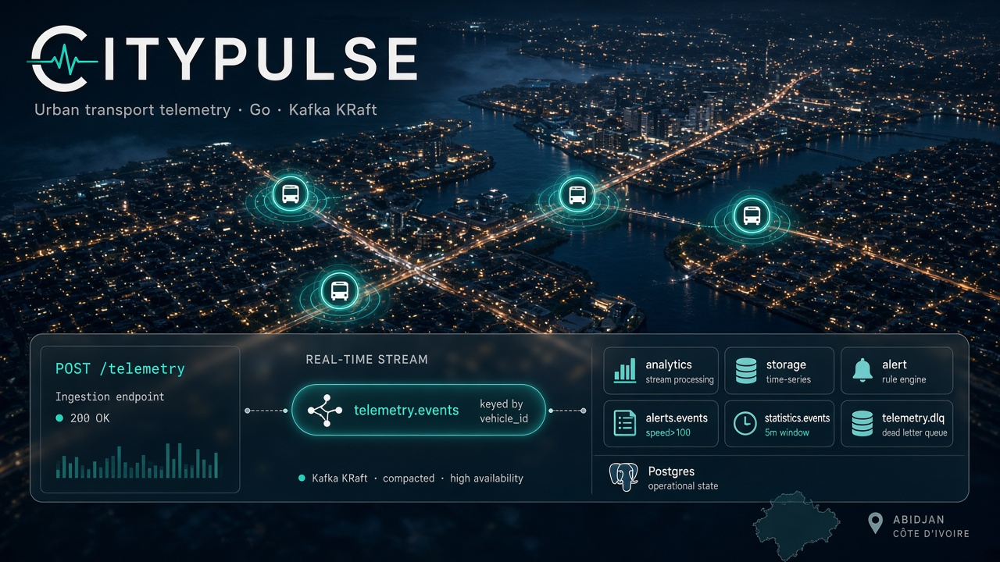
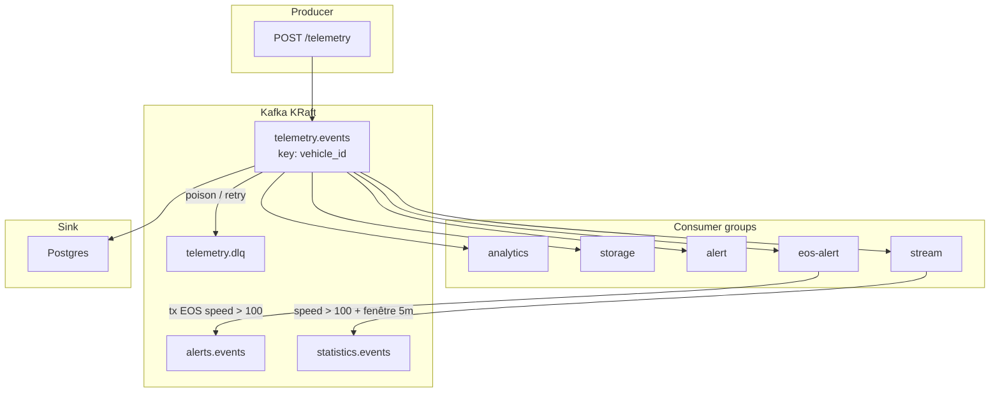

# CityPulse



> Télémétrie transport urbain en temps réel — Go + franz-go + Kafka KRaft : producer HTTP, consumer groups, partitions, DLQ, EOS, stream, Connect

## Avertissement — projet fictif

CityPulse est un **projet pédagogique fictif**. Il simule une plateforme de télémétrie pour bus urbains (type flotte SOTRA / smart city) dans le but d’apprendre Apache Kafka de bout en bout. Il ne s’agit pas d’un produit réel, d’un opérateur de transport ni d’un déploiement en production en Côte d’Ivoire. Noms, bus Abidjan (`BUS-001`, coordonnées `5.35, -4.01`) et métriques illustrent un scénario fictif uniquement.

## À propos

**CityPulse** est une **simulation** d’ingestion et de traitement d’événements GPS — conçue pour implémenter une architecture événementielle résiliente avec Kafka KRaft : producer HTTP, plusieurs consumer groups, clé de partition, retry / DLQ, idempotence, transactions EOS, fenêtres de stream et sink Postgres.

Le système cible un déploiement régional centré sur **Abidjan** et la **Côte d’Ivoire** : chaque bus émet de la télémétrie, les alertes de vitesse excessive alimentent un hub régional.

## Architecture

### Composants

| Composant | Rôle |
|-----------|------|
| **`cmd/telemetry`** | API HTTP `POST /telemetry` — valide le payload, génère `event_id`, produit sur Kafka |
| **Kafka KRaft** | Cœur du système — topics, partitions, replication, consumer groups |
| **`cmd/analytics`** | Consumer group `analytics` — lit `telemetry.events`, log la vitesse |
| **`cmd/storage`** | Consumer group `storage` — même topic, persistance / traitement indépendant |
| **`cmd/alert`** | Consumer group `alert` — signale les vitesses excessives |
| **`cmd/stream`** | Filtre `speed > 100` + moyenne par `vehicle_id` (fenêtre tumbling 5 min) → `statistics.events` |
| **`cmd/eos-alert`** | Read-process-write transactionnel → `alerts.events` (exactly-once) |
| **Kafka Connect JDBC** | Sink vers Postgres 16 |

### Topics

| Topic | Usage |
|-------|--------|
| `telemetry.events` | Flux principal (clé = `vehicle_id`) |
| `telemetry.dlq` | Messages poison / échecs de traitement |
| `alerts.events` | Alertes vitesse (EOS ou filtre stream) |
| `statistics.events` | Moyennes de vitesse par fenêtre 5 min |

### Flux global



## Features

### 1. Ingestion HTTP (JSON puis Protobuf)

**Scénario métier :** Les bus en circulation poussent position, vitesse et horodatage vers une API unique. Le producteur ne connaît pas les consommateurs.

**Implémentation Kafka :**

- `POST /telemetry` sur `:8080` (stdlib `net/http`)
- Contrat `TelemetryEvent` : `event_id`, `vehicle_id`, `latitude`, `longitude`, `speed`, `timestamp`
- Sérialisation JSON d’abord, puis Protobuf (`api/telemetry.proto`) avec évolution de schéma

**Comportement attendu :** HTTP `202` = événement accepté et produit ; le client peut omettre `event_id` (généré côté serveur).

### 2. Consumer groups indépendants

**Scénario métier :** Analytics, stockage et alertes doivent traiter **le même** événement sans se bloquer mutuellement.

**Implémentation Kafka :**

- Trois groups sur `telemetry.events` : `analytics`, `storage`, `alert`
- Chaque event est traité N fois (une par group)

**Comportement attendu :** Un `curl` unique apparaît dans les logs des trois process — découplage producer → Kafka → consumers.

### 3. Clé `vehicle_id` et ordre par bus

**Scénario métier :** Les positions d’un même bus doivent rester ordonnées pour le calcul de trajet et les alertes.

**Implémentation Kafka :**

- Clé de message = `vehicle_id` (UTF-8)
- Partitions : tous les events d’un bus vont sur la même partition

**Comportement attendu :** Ordre par véhicule garanti à l’intérieur d’une partition ; parallélisme entre bus.

### 4. Résilience — retry, DLQ, idempotence, acks

**Scénario métier :** Un JSON cassé ou un doublon HTTP ne doit ni bloquer le group, ni créer deux alertes pour le même `event_id`.

**Implémentation Kafka :**

- Retry puis routage vers `telemetry.dlq`
- Dedup côté consumer via `event_id`
- Producer idempotent + `acks` adaptés

**Comportement attendu :** Poison message visible en DLQ ; republier le même `event_id` n’alerte qu’une fois.

### 5. Cluster KRaft 3 nœuds et transactions EOS

**Scénario métier :** Une alerte de speeding doit être écrite sur `alerts.events` **atomiquement** avec le commit d’offset (pas d’alerte orpheline, pas de trou).

**Implémentation Kafka :**

- Compose HA : 3 brokers KRaft (`docker-compose.ha.yml`)
- `cmd/eos-alert` : transaction read-process-write si `speed > 100`

**Comportement attendu :** Alerte et offset commités ensemble — exactly-once semantics sur ce chemin.

### 6. Stream, Connect, observabilité, sécurité

**Scénario métier :** Filtrer les excès de vitesse, agréger par fenêtre, stocker en SQL, mesurer le lag, durcir l’accès.

**Implémentation Kafka :**

- `cmd/stream` : filtre immédiat + moyenne tumbling 5 min → `statistics.events`
- Kafka Connect JDBC → Postgres 16
- Lag via `kafka-consumer-groups`
- Overlay SASL/PLAIN + ACL (sans casser le chemin PLAINTEXT critique)

**Comportement attendu :** `BUS-001` à 42 km/h (flux normal) puis 125 km/h (alerte) ; lag ~0 sur les groups actifs.

## Stack technique

- **Go** ≥ 1.22
- **franz-go** (`github.com/twmb/franz-go`) — producer, consumer, transactions, admin
- **`net/http`** — API `POST /telemetry`
- **Docker Compose** — image `apache/kafka:3.9.1`, mode KRaft (sans ZooKeeper)
- **Protobuf** (`protoc`) — sérialisation évolutive
- **Kafka Connect JDBC** + **Postgres 16** — sink
- Config via `os.Getenv` (`KAFKA_BROKERS=localhost:9092`)

## Quick Start

Prérequis : Docker Compose + Go ≥ 1.22.

```bash
export KAFKA_BROKERS=localhost:9092

cd deployments/kafka
docker compose up -d

cd ../..
go run ./cmd/telemetry
# autres terminaux :
go run ./cmd/analytics
go run ./cmd/storage
go run ./cmd/alert
```

Test manuel :

```bash
curl -s -X POST http://localhost:8080/telemetry -H 'Content-Type: application/json' \
  -d '{"vehicle_id":"BUS-001","latitude":5.35,"longitude":-4.01,"speed":42}'

curl -s -X POST http://localhost:8080/telemetry -H 'Content-Type: application/json' \
  -d '{"vehicle_id":"BUS-001","latitude":5.36,"longitude":-4.01,"speed":125}'
```

Attendu : analytics / storage loggent les 2 events ; alert (ou stream / eos-alert) signale le speeding sur 125.

## Checklist Scalabilité et Robustesse

> Projet fictif — checklist indiquant ce qui est implémenté vs extensions prod futures.

### Scalabilité

- [x] **Infra KRaft locale (Compose)** — *Pourquoi* : ZooKeeper ajoute de la friction sans gain. *Sert à* : un broker (puis 3 nœuds) prêt en une commande.
- [x] **Producer HTTP + contrat JSON / Protobuf** — *Pourquoi* : le client métier ne parle pas Kafka. *Sert à* : valider et produire des `TelemetryEvent` typés.
- [x] **3 consumer groups sur le même topic** — *Pourquoi* : un seul consumer = couplage. *Sert à* : analytics, storage et alert indépendants.
- [x] **Clé `vehicle_id`** — *Pourquoi* : sans clé, l’ordre par bus est aléatoire. *Sert à* : sticky partition + ordering.
- [x] **Cluster 3 nœuds KRaft** — *Pourquoi* : mono-nœud = single point of failure. *Sert à* : redondance locale.
- [x] **Stream fenêtre 5 min + Connect Postgres** — *Pourquoi* : Kafka seul n’agrège ni ne stocke en SQL. *Sert à* : stats et sink JDBC.
- [ ] **Grafana / Prometheus** — *Pourquoi* : le lag CLI est un snapshot. *Sert à* : dashboards et alertes continues.
- [ ] **Multi-région / MirrorMaker** — *Pourquoi* : un cluster Abidjan ne couvre pas plusieurs pays. *Sert à* : réplication inter-régions.
- [ ] **Schema Registry** — *Pourquoi* : Protobuf local suffit ici. *Sert à* : gouvernance de schémas en équipe.

### Robustesse

- [x] **Retry + DLQ + idempotence `event_id`** — *Pourquoi* : poison et doublons HTTP sont réalistes. *Sert à* : files d’erreurs et alertes uniques.
- [x] **Acks / producer idempotent** — *Pourquoi* : perte silencieuse côté producteur. *Sert à* : reliability du chemin critique.
- [x] **Transactions EOS (`eos-alert`)** — *Pourquoi* : at-least-once ne suffit pas pour les alertes. *Sert à* : write alerte + commit offset atomiques.
- [x] **Lag + SASL/PLAIN ACL + `go test`** — *Pourquoi* : sans lag visible et sans auth, le debug est aveugle. *Sert à* : observabilité minimale et overlay sécu.
- [ ] **Auth HTTP (JWT) + rate limiting** — *Pourquoi* : `/telemetry` ouvert par défaut. *Sert à* : contrôler qui injecte.
- [ ] **UI carte temps réel** — *Pourquoi* : hors objectif Kafka. *Sert à* : visualisation métier des bus.
